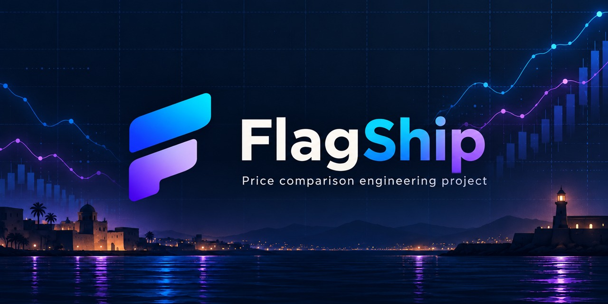
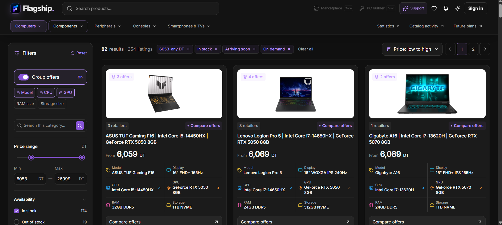
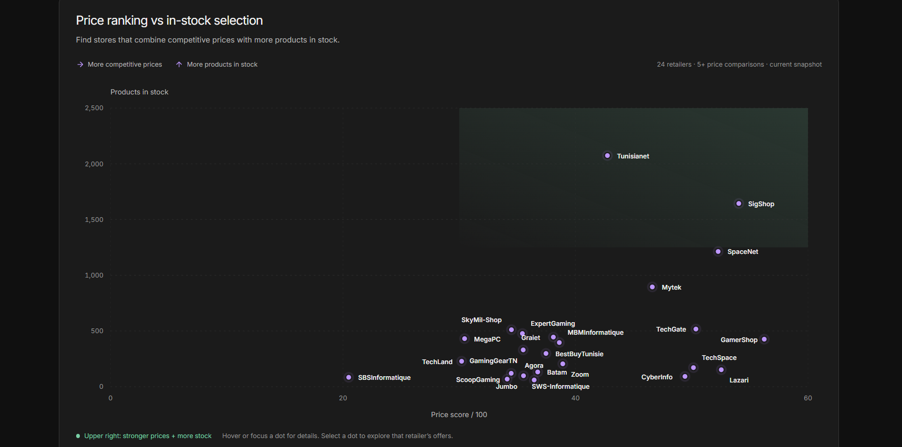
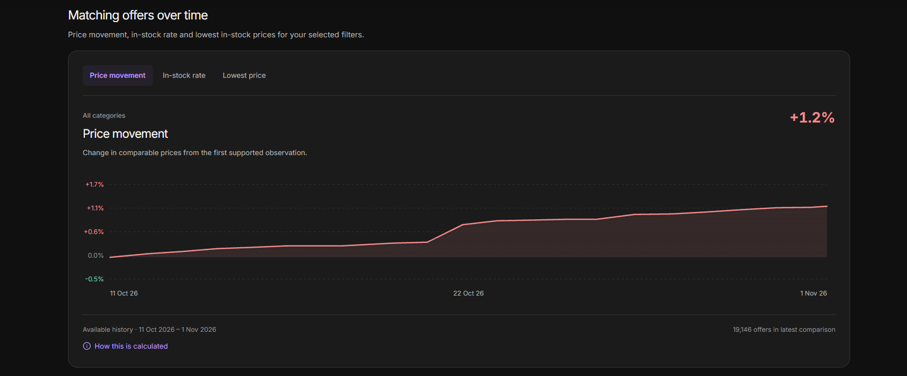
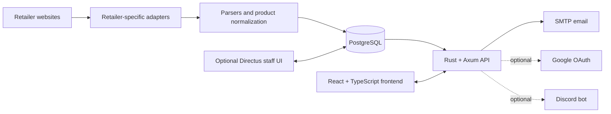

# FlagShip



**A full-stack price comparison platform for Tunisia's e-commerce market.** FlagShip aggregates technology listings from local retailers, normalizes product data, compares offers, and tracks price history.

[Live site](https://flagship.tn) · [Run locally](#run-locally) · [MIT License](LICENSE)

> **Completed project · not actively maintained.** Retailer integrations and the hosted site may stop working as retailer websites change. This repository is preserved for learning and exploration; prices and availability are not guaranteed.

## Features

- Search and discover products across technology categories, with sorting and structured filters.
- Compare retailer offers and stock status. The active scanner registry contains **24 retailer adapters**; 10 additional adapter modules are disabled or commented out.
- Normalize product titles and specifications into categories, variants, and comparable listings.
- Record offer changes and explore product history, market trends, retailer statistics, and catalog activity.
- Save wishlists and email price alerts with an account; Google sign-in is optional.
- Send optional Discord scan notifications and manage catalog data through an optional Directus staff interface.

**Planned, not implemented:** PC builder and marketplace experiences. The roadmap voting page exists; those proposed products do not.

At its peak, FlagShip's catalog contained approximately **40,000 products**. The production catalog is not included in this repository.

## Screenshots

<table>
  <tr>
    <td align="center"><a href="assets/catalog-and-filters.png"></a></td>
    <td align="center"><a href="assets/retailer-landscape.png"></a></td>
    <td align="center"><a href="assets/price-history.png"></a></td>
  </tr>
</table>

## Technology


| Backend                          | Frontend                   | Data and operations               |
| -------------------------------- | -------------------------- | --------------------------------- |
| Rust 2024, Tokio, Axum           | React 19, TypeScript, Vite | PostgreSQL, SQLx migrations       |
| `reqwest`, `scraper`, Playwright | Tailwind CSS, Lucide       | HTTP and Chromium-backed scraping |

## Architecture



Each adapter handles a retailer's page structure and pagination. Shared fetch clients, category parsers, product models, scan reports, and error tracking connect those adapters to the catalog and API. Retailer markup and access behavior change often, so integrations may need updates before they work against current sites.

## Repository layout

```text
src/          Rust API, catalog, accounts, alerts, scrapers, Discord integration
website/      React + TypeScript application
config/       Categories, parser data, normalization rules, roadmap
migrations/   PostgreSQL schema migrations
deploy/       Local launcher, Directus, database and deployment examples
docs/setup.md Development setup and environment variables
assets/       Project banner, icons, and product screenshots
```

The repository contains source configuration, not the production database or collected catalog. `.env`, local state, backups, and build outputs are excluded from Git.

## Run locally

### Prerequisites

- Rust stable with Rust 2024 edition support (Rust 1.85 or newer).
- Node.js 22.12 or newer and npm. Node 22 LTS is recommended; Directus setup requires Node 22.
- PostgreSQL 17 for the Windows launcher. On Linux, install PostgreSQL and ensure `psql` is available on `PATH`.
- Git. Setup installs website and Directus dependencies and attempts to install Chromium for browser-backed scraping.

### 1. Clone and configure

```sh
git clone https://github.com/7azeemm/Flagship.git
cd Flagship
```

Copy `.env.example` to `.env` (`Copy-Item .env.example .env` in PowerShell), then replace every `replace-me-` value. Keep `.env` private. The local launcher expects a PostgreSQL database and role named `flagship`; set `DATABASE_URL` and `FLAGSHIP_DB_PASSWORD` to matching credentials. Setup also initializes Directus, so provide local values for its secret, database password, admin email/password, and admin token. See [docs/setup.md](docs/setup.md) for every variable and troubleshooting.

### 2. Set up the database and dependencies

Windows:

```bat
start.bat setup
```

Linux:

```sh
sh start.sh setup
```

Setup connects to PostgreSQL, creates/configures the application roles and database, applies migrations, installs the website and Directus dependencies, builds the frontend, installs Chromium, and initializes Directus. On Linux, Chromium setup may prompt for `sudo` to install system dependencies. On Windows, the launcher uses the bundled Node 22 runtime at `state/node22` if present; otherwise it uses Node on `PATH`. On Linux, it uses `state/node22/bin/node` if present, otherwise `node` on `PATH`.

### 3. Start the application

For backend plus live Vite frontend:

```bat
start.bat dev
```

```sh
sh start.sh dev
```

Open `http://127.0.0.1:5173`. The Rust API listens on `http://127.0.0.1:3000`; Vite proxies API requests to it. Press **Ctrl+C** to stop processes started by the launcher. PostgreSQL remains running as a system service.

Useful launcher modes:


| Command                                                             | What it starts                                                                   |
| ------------------------------------------------------------------- | -------------------------------------------------------------------------------- |
| `start.bat setup` / `sh start.sh setup`                             | One-time local setup and migrations                                              |
| `start.bat dev` / `sh start.sh dev`                                 | Rust backend and live Vite development server                                    |
| `start.bat serve` / `sh start.sh serve`                             | Build the frontend, then serve it with the backend                               |
| `start.bat directus` / `sh start.sh directus`                       | Directus staff interface only                                                    |
| `start.bat all` / `sh start.sh all`                                 | Backend, frontend, and Directus                                                  |
| `start.bat production` / `sh start.sh production`                   | Build and run the production backend/frontend; requires production configuration |
| `start.bat production-directus` / `sh start.sh production-directus` | Start Directus using the release binary for migrations                           |
| `start.bat apply-overrides` / `sh start.sh apply-overrides`         | Replay saved product overrides and exit                                          |
| `start.bat reset` / `sh start.sh reset`                             | Delete and recreate the local database after explicit confirmation               |
| `start.bat --help` / `sh start.sh --help`                           | Show launcher modes and notes                                                    |

The Windows wrapper pauses after the launcher exits; the Linux wrapper returns directly to the shell. Press **Ctrl+C** to stop long-running modes. The clean database starts without the historical product catalog. Scraping is disabled by default; set `ENABLE_SCANNING=true` in `.env` only when you intentionally want to request retailer websites. SMTP settings are required at backend startup for account and alert email; valid Google OAuth and Discord credentials are optional. The `reset` mode deletes local database contents, so back up anything you need first.

## License

FlagShip's original code and documentation use the **MIT License**. In practical terms, you may use, modify, redistribute, and include the project in commercial work, provided you keep the copyright and license notice. The software comes without warranty. Read the full terms in [`LICENSE`](LICENSE).

This license does not grant rights to retailer names, trademarks, product images, listings, collected data, or third-party dependencies. The optional Directus dependency uses its own MSCL license and is not covered by FlagShip's MIT license. No production catalog data is redistributed here.

See [CONTRIBUTING.md](CONTRIBUTING.md) before opening a pull request.
